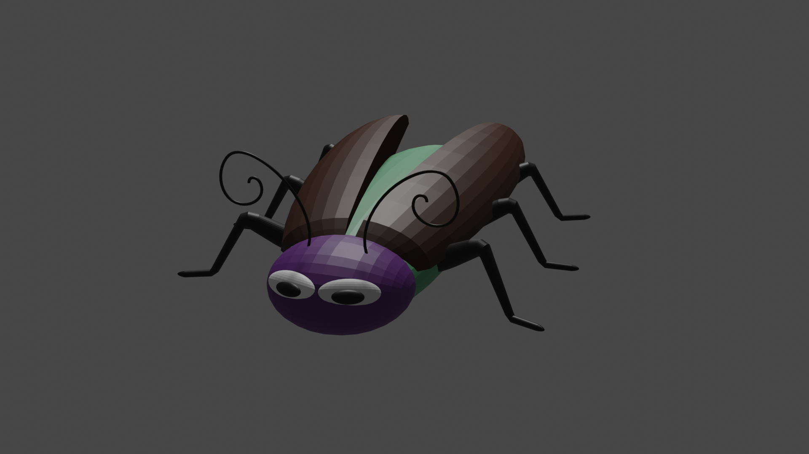
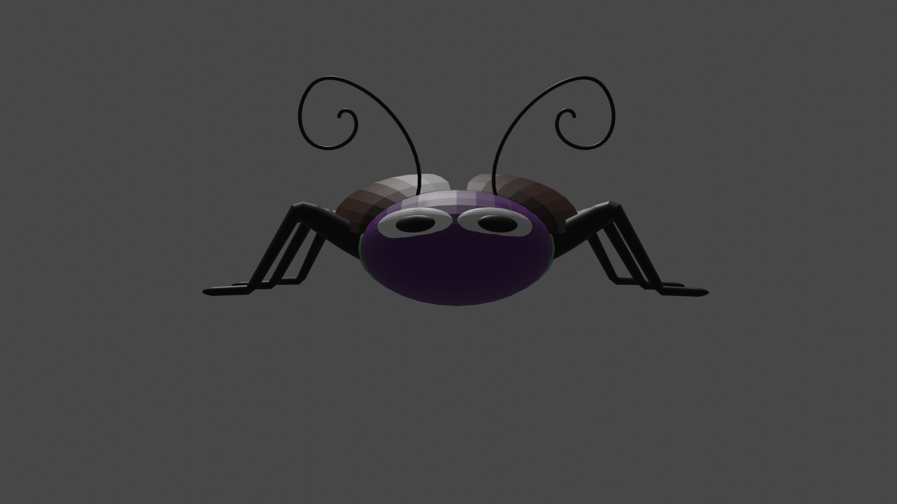
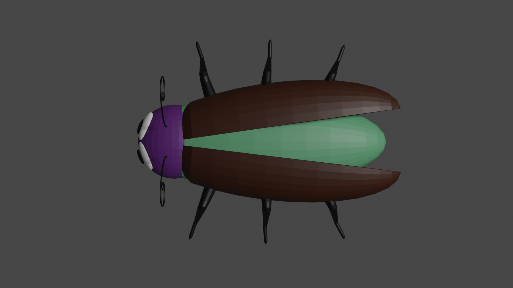
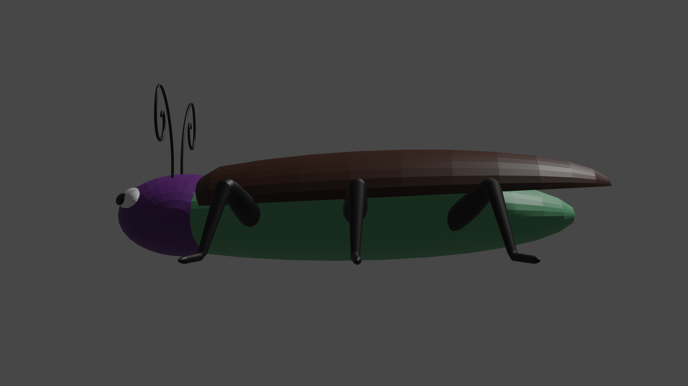

# Cartoon Cockroach

A low-poly cartoon cockroach modeled in Blender. This is a hobby project made for fun.



## About

A friendly, big-eyed cockroach with a purple head, brown wing covers (elytra) that open to reveal a green body, curly antennae and black jointed legs. The flat shading shows off the faceted, low-poly look.

## Renders

| Front | Top |
|---|---|
|  |  |

| Side |
|---|
|  |

## Files

```
├── cockroach.blend    # source scene
└── renders/           # PNG renders from several angles
```

## Software

- Blender 3.6

## Usage

Open `cockroach.blend` in Blender 3.6 or newer.

## Author

Anastasia Shestopal
